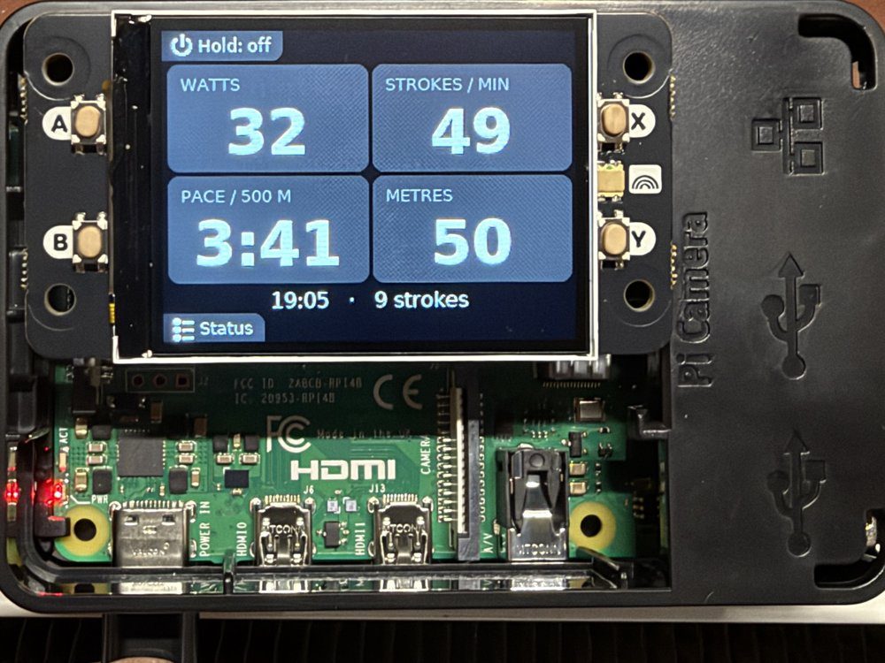
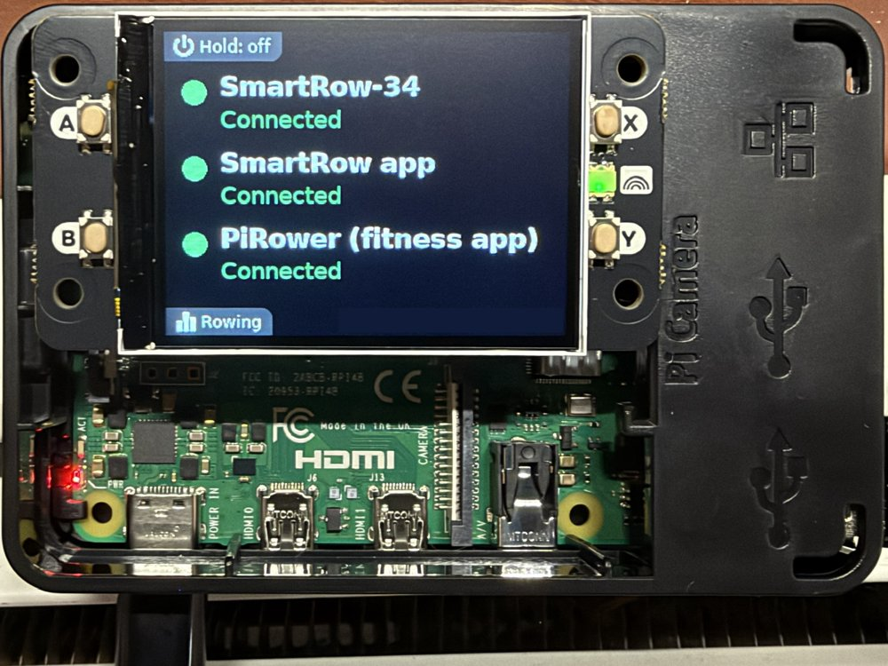
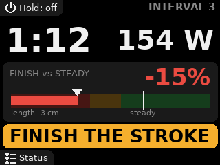
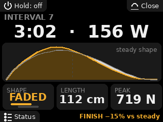
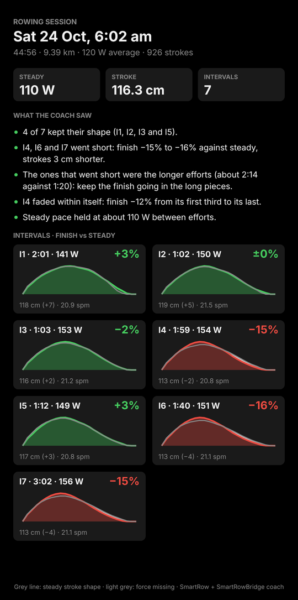

# SmartRowBridge

Row on a **SmartRow** with the **Peloton app** - and keep using the SmartRow app at the same time.

The SmartRow pulley only talks to the SmartRow app. The app can broadcast your rowing to a list of other
apps, but Peloton is not one of them: the Peloton app can connect to that broadcast, but it reads the data
wrongly (the distance rowed, for example, climbs far too fast). This bridge fills that gap: a Raspberry Pi
holds the only Bluetooth connection the pulley allows and re-publishes it as two devices:

- **`PiRower`** - a standard Bluetooth fitness machine (FTMS rower), which the Peloton app can connect to;
- **`SmartRow`** - a byte-for-byte copy of your pulley, for the SmartRow app (force curves and all).

Both apps record the same strokes. Switch the Pi on, pull the handle, open your apps.



**Do you need this?** Only if the app you want is Peloton, or another app that accepts a standard Bluetooth
rower but that the SmartRow app cannot broadcast to. At the time of writing the SmartRow app broadcasts to
EXR, Kinomap, Zwift, Bitgym, Regatta, ImersU, Holofit and ErgZone
([SmartRow's FAQ](https://smartrow.fit/faq-smartrow-app/) has the current list). If your app is on that
list, the SmartRow app already does the job without any extra hardware.

```
SmartRow pulley ──BLE──> Pi built-in radio (central, bleak/BlueZ)
                              │ raw notifications, byte for byte
                              ├──────────> "SmartRow" ──> tablet / phone running the SmartRow app
                              │ <── the app's commands forwarded to the pulley ──
                              └─ parse → watts / stroke rate / pace / distance / time
                                           "PiRower" ──> phone / tablet running Peloton (FTMS 0x2AD1)
USB Bluetooth dongle (peripheral, Bumble): two advertising sets, two connections, one GATT server
```

> **Unofficial.** This project is not affiliated with or endorsed by SmartRow, WaterRower, Peloton or
> anyone else. It was worked out from a pulley's Bluetooth traffic and may stop working after a firmware
> or app update. Use it at your own risk.

## Status

Working on the author's setup: SmartRow pulley firmware **V3.10**, Raspberry Pi 4 and TP-Link UB500, with

- the SmartRow app on an Android tablet (Lenovo), an iPhone and an iPad;
- the Peloton app on an Android tablet (Lenovo), an iPhone and an iPad.

The optional [status screen](#optional-a-status-screen-on-the-pi) (Pimoroni Display HAT Mini) is tested on
the same Pi 4.

Cold boot to both apps recording needs no interaction. Other firmware versions, dongles and apps are
untested - reports welcome.

The [interval coach](#optional-interval-coach-experimental) and the
[web page](#optional-a-web-page-for-phones-and-tablets) are new and experimental: the coach is calibrated on
the author's rowing only and is off unless turned on; the web page has not yet been tried on a tablet.

Peloton shows stroke rate, pace and heart rate live, and output (watts, kJ), distance and stroke count in the
workout summary.

## What you need

| Part | Notes |
|---|---|
| Raspberry Pi 4 | Other models with built-in Bluetooth probably work; untested |
| microSD card | Raspberry Pi OS **Lite (64-bit)**, flashed with Raspberry Pi Imager (see [Prepare the Pi](#1-prepare-the-pi)) |
| USB Bluetooth dongle | TP-Link **UB500** (Realtek RTL8761BU). It must support LE extended advertising; other Bluetooth 5 dongles may work |
| SmartRow pulley | Firmware V3.10 tested |
| Two devices for the apps | The SmartRow app on one, the fitness app on another (or the same one) |

Why two radios: the built-in radio is the *client* of the pulley, and the dongle is driven directly by
[Bumble](https://github.com/google/bumble) to host the two virtual devices.

## Install

### 1. Prepare the Pi

Skip this if your Pi already runs Raspberry Pi OS Lite (64-bit) and you can reach it over SSH.

1. Flash the microSD card with [Raspberry Pi Imager](https://www.raspberrypi.com/software/). The Imager
   lists its steps down the left side; these are the ones in version 2. Older versions ask for the same
   things in a different layout.

   | Step | What to do |
   |---|---|
   | **Device** | Choose your Pi model |
   | **OS** | Choose **Raspberry Pi OS (other)**, then **Raspberry Pi OS Lite (64-bit)** |
   | **Storage** | Choose the microSD card |
   | **Customisation: Hostname** | A name for the Pi on your network, e.g. `rowbridge`. You use it to connect in step 3 |
   | **Customisation: Localisation** | Your country's capital, your time zone and your keyboard layout. The time zone sets the times shown in the bridge's log |
   | **Customisation: User** | A user name and password. You need both to connect in step 3 |
   | **Customisation: Wi-Fi** | **Secure network**, then your network's name (SSID) and its password, twice |
   | **Customisation: Remote access** | Turn on **Enable SSH** and choose **Use password authentication** |
   | **Customisation: Raspberry Pi Connect** | Leave it off: it is Raspberry Pi's service for reaching a Pi from outside your home through their website, and the bridge does not use it |
   | **Writing** | Check that the summary lists the hostname, localisation, user account, Wi-Fi and SSH, then click **Write** |

2. Put the card in the Pi, plug in the USB Bluetooth dongle and power the Pi on. The first boot takes a
   minute or two.
3. Connect from your computer: `ssh <user>@<hostname>.local`, with the user and hostname you set in the Imager.

### 2. Install the bridge

On the Pi, over SSH, with the USB Bluetooth dongle plugged in:

```bash
sudo apt-get update && sudo apt-get install -y git
git clone https://github.com/madooroy/SmartRowBridge.git ~/smartrow-bridge
cd ~/smartrow-bridge
sudo bash install.sh
```

The installer puts the code in `/opt/smartrow-bridge`, creates the `smartrow-bridge` service (starts on every
boot) and the settings file `/etc/default/smartrow-bridge`. No settings are required.

No reboot is needed: the bridge starts as soon as the installer finishes, and from then on at every boot.

### 3. Check it

Pull the handle to wake the pulley, then run:

```bash
sudo bash ~/smartrow-bridge/tools/health_check.sh
```

### 4. Pair the apps (once)

The SmartRow app has to be paired again, this time with the Pi's copy of your pulley instead of the pulley
itself. The copy has the same name and number as the real one, so it is easy to think nothing needs doing.

1. **SmartRow app**: forget (remove) the pulley you have paired now, then pair the one that appears as
   **`SmartRow-<number>`**. It shows the same number as before, because the bridge copies the pulley's ID,
   but it is the Pi you are pairing with. From then on it reconnects by itself.
2. **Peloton** (or another FTMS app): add the rower called **`PiRower`**.

The real pulley no longer shows up in the apps while the bridge is running: the bridge is holding its
connection, so the only `SmartRow-<number>` you can see is the Pi's copy.

## Everyday use

1. Power on the Pi and pull the handle straight away. The virtual devices appear once the pulley has
   connected, about 20 s after power-on.
2. Open the SmartRow app and/or your fitness app. Row.
3. Shut the Pi down before cutting power (`sudo shutdown -h now`, wait for the green LED to go dark).
   To do that with one tap on an iPhone, see [switching the Pi off from an iPhone](#optional-switch-the-pi-off-from-an-iphone).

Updating: `cd ~/smartrow-bridge && git pull && sudo bash install.sh`.

Pulley firmware updates still come from the SmartRow app talking to the real pulley: stop the bridge first
(`sudo systemctl stop smartrow-bridge`), update, start it again.

## Checking and troubleshooting

```bash
sudo bash ~/smartrow-bridge/tools/health_check.sh
```

It is read-only and checks the service, the installed code, the settings, both radios, the last rowing
session (pulley data received → forwarded to the SmartRow app → FTMS sent to the fitness app), warnings, and
the SD card and power supply. It works after a reboot too: the bridge keeps a small record of each session in
`/var/lib/smartrow-bridge/sessions.log`.

| Tool | Use |
|---|---|
| `tools/health_check.sh` | Everything above, in one screen |
| `tools/check_adapters.py` | Lists both radios (MAC, type, USB ID) and scans with each |
| `tools/pulley_rssi.py` | Live signal strength of the pulley link. Aim for −75 dBm or better; move the Pi closer if not |
| `tools/sniff_pulley.py` | Connects to the pulley directly and prints its services and raw packets (stop the bridge first) |
| `tools/setup_shutdown_shortcut.sh` | Lets an iOS Shortcut shut the Pi down, and nothing else, see [switching the Pi off from an iPhone](#optional-switch-the-pi-off-from-an-iphone) |
| `tools/faster_startup.sh` | Optional boot-time tuning of the Pi, see [faster start-up](#optional-faster-start-up) |
| `tools/setup_display.sh` | Optional status screen, see [a status screen on the Pi](#optional-a-status-screen-on-the-pi) |

Live log: `journalctl -u smartrow-bridge -f`. Raspberry Pi OS keeps the log in memory, so save it before
shutting down if you want to share it: `journalctl -u smartrow-bridge -b --no-pager > ~/bridge.log`.

Common problems:

- **Both radios "not powered" / nothing happens** - Bluetooth is soft-blocked on a fresh image:
  `sudo rfkill unblock bluetooth` (the installer does this).
- **The dongle is not found** - `lsusb` should list it; `dmesg | grep -i rtl` should show its firmware loading.
- **Apps cannot see `SmartRow` / `PiRower`** - they only appear after the pulley has connected. Pull the handle.
- **The SmartRow app does not reconnect after you replaced the pulley** - it is a different pulley ID; pair
  the new `SmartRow-<number>` once.

## Settings

`/etc/default/smartrow-bridge` - all optional. Restart after a change: `sudo systemctl restart smartrow-bridge`.

| Setting | Default | Meaning |
|---|---|---|
| `SRB_PULLEY_ADDRESS` | empty | Empty = the first device advertising the SmartRow service; a MAC pins one pulley (use where several SmartRows are in range) |
| `SRB_FITNESS_NAME` | `PiRower` | The name fitness apps see |
| `SRB_CLONE_NAME` | the pulley's name | The name the SmartRow app sees. Leave it empty: a test with `SmartRowPi` did not work with the SmartRow app |
| `SRB_CLONE_ADDRESS`, `SRB_FITNESS_ADDRESS` | derived from the dongle's MAC | Addresses of the two virtual devices: the same on every boot, unique per Pi |
| `SRB_ADVERTISE_PULLEY_ID` | `1` | Test only: `0` advertises the clone without the pulley ID (manufacturer data), as an iPhone would; change `SRB_CLONE_ADDRESS` too so the app sees a new device |
| `SRB_CENTRAL_MAC`, `SRB_PERIPHERAL_MAC` | empty | Empty = built-in radio for the pulley, USB dongle for the apps; set the radios' MACs to pin them |
| `SRB_DRIVE_WITHOUT_TABLET` | `1` | The bridge runs the pulley's start-up handshake itself when the SmartRow app is not connected, so the fitness app works alone |
| `SRB_SESSION_LOG` | `/var/lib/smartrow-bridge/sessions.log` | Session record that survives shutdown; `off` disables |
| `SRB_SNIFF_LOG` | empty | Append every raw pulley packet to this file |
| `SRB_GATT_LOG` | empty | `1` logs every GATT request the apps make to the virtual devices (verbose) |
| `SRB_LOG_LEVEL` | `INFO` | `DEBUG` adds a line per second |
| `SRB_STATUS_FILE` | `/run/smartrow-bridge/status.json` | Status the optional screen shows, rewritten every second in RAM; `off` disables |
| `SRB_COACH` | `0` | `1` turns on the [interval coach](#optional-interval-coach-experimental) (experimental) |
| `SRB_COACH_START_PCT`, `SRB_COACH_MAX_MIN`, `SRB_COACH_SENSITIVITY` | `20`, `5`, `normal` | Coach tuning: how much harder than steady an interval is (%), the longest effort to count (minutes), how readily the cues speak up (`low`, `normal`, `high`) |
| `SRB_WEB_PORT` | `8080` | Port of the optional [web page](#optional-a-web-page-for-phones-and-tablets) |
| `SRB_DISPLAY_LED`, `SRB_DISPLAY_HOLD_S` | `1`, `2` | Screen only: `0` leaves its LED off; seconds to hold button A to switch the Pi off |

## How it works

| Module | Role |
|---|---|
| `smartrow_bridge/central.py` | Finds and holds the pulley, copies its GATT table, reconnects, keeps writes in order |
| `smartrow_bridge/peripheral.py` | Bumble GATT server: pulley clone + FTMS rower, two advertising sets |
| `smartrow_bridge/protocol.py` | SmartRow record decoding (including each stroke's force curve), checksum, V3 KEYLOCK handshake |
| `smartrow_bridge/coach.py` | Interval coach: steady reference, automatic interval detection, live cue, per-interval summary |
| `smartrow_bridge/ftms.py` | FTMS Rower Data (0x2AD1), Feature, Control Point |
| `smartrow_bridge/bridge.py` | Wiring; runs the pulley handshake when the SmartRow app is absent; 1 Hz FTMS; data-flow log |
| `smartrow_bridge/adapters.py` | Picks the two radios, clears rfkill, hands the dongle to Bumble |
| `smartrow_bridge/addresses.py`, `advertising.py`, `session_log.py`, `config.py` | Virtual device addresses, advertising payloads, session record, settings |
| `smartrow_bridge/status.py`, `smartrow_bridge/display/`, `smartrow_bridge/web/` | Status file; the optional screen and web page, separate services that only read it |
| `smartrow_bridge/sessions.py` | Saves each session's summary for the web page; progress over weeks |
| `smartrow_bridge/heartrate.py` | Optional heart rate strap, on the pulley's radio |
| `smartrow_bridge/uploads.py`, `intervals.py`, `strava.py`, `fitfile.py` | Optional uploads: when and where, the two services, the session's FIT file |
| `tools/coach_replay.py` | Runs SmartRow app CSV exports through the coach (and can save their summaries) |

- **Pass-through.** Every pulley notification is forwarded to the clone first, unchanged and in order; parsing
  works on a copy. The SmartRow app's writes go back to the pulley unchanged.
- **Who talks to the pulley.** The pulley streams only after an init command, a `$` poll every ~2 s and, on V3
  firmware, a KEYLOCK challenge-response. The SmartRow app does that through the clone. While the app is not
  connected, the bridge does it, so a fitness app works on its own.
- **Stopping.** After you stop, the pulley keeps repeating the last stroke's values; the bridge zeroes the live
  values when the pulley's "stopped" marker arrives or no new stroke comes for 6 s.

Tests (no Bluetooth needed): `python -m unittest discover -s tests -t .` - they replay a real 2½-minute capture
(`captures/sniff2.log`).

### SmartRow protocol notes (firmware V3.10)

Service `0x1234`; `0x1235` write without response; `0x1236` read + notify. The pulley advertises its ID as
manufacturer data under company id `0x1235` (the SmartRow app shows it as `SmartRow-<id>`).

What the SmartRow app needs from a clone (tested with the Android and iOS apps): the iOS app lists a device
only if that manufacturer data is advertised, and after connecting it uses the service only if `0x1234`,
`0x1235` and `0x1236` are declared as 16-bit UUIDs. The Android app accepts a clone without the manufacturer
data (it lists it as plain `SmartRow`) and with either UUID form.

Handshake: write `$\rV@\r` → version reply (`SmartRow 'V3.10'`) → write `#` → `KEYLOCK=…` → answer → records
stream at about 10 per second.

Records are 17 ASCII bytes: type, distance in metres (bytes 1-5, high nibble scrambled on V3), fields, hex
checksum of bytes 0-13 (bytes 14-15), CR.

| Record | Fields |
|---|---|
| `a` | elapsed time `MMMSS` [6:11] |
| `c` | instantaneous W [6:9], average W×10 [9:14] |
| `d` | strokes/min ×10 [6:9], stroke count [9:13] |
| `e` | instantaneous split `mss` [6:9], average split [9:12] |
| `f` | `!` at [11] = rowing stopped |
| `b` | work J×10 [6:11], stroke length cm [11:14] |
| `x`, `y`, `z` | force curve: 8 samples each at [6:14], catch to finish (24 per stroke); sample = (code − `!`) × 16 N |

The force curve of a stroke arrives as `x`, `y`, `z`, then that stroke's `b` record. The decoding matches a
SmartRow app CSV export exactly (every force value is a multiple of 16 N), and the curve's integral over the
stroke length comes within about 10 % of the `b` record's work. The `c` record's instantaneous power is the
*previous* stroke's (the same lag shows in the app's CSV export), so the coach uses each stroke's own
work × rate / 60 instead. None of this changes what is forwarded to the apps.

## Optional: switch the Pi off from an iPhone

The Pi should be shut down before its power is cut. This sets up a button on your iPhone or iPad that does
it with one tap, with no password and no SSH app. The phone gets a key that can do exactly one thing on the
Pi: shut it down.

1. **Create the shortcut.** In the **Shortcuts** app, tap **+**, add the action **Run Script Over SSH**, and
   fill it in:

   | Field | Value |
   |---|---|
   | Host | your Pi's name, e.g. `raspberrypi.local` |
   | Port | `22` |
   | User | your user on the Pi, e.g. `pi` |
   | Authentication | **SSH Key** |
   | Script | `sudo -n /usr/sbin/shutdown -h now` |

   Name the shortcut, e.g. **Pi Off**.

2. **Copy the phone's public key.** In the same action, tap the **SSH Key** row and choose **Copy Public
   Key**. Get that line of text to the computer you use for SSH - for example paste it into a note or an
   e-mail to yourself. It starts with `ssh-ed25519` or `ssh-rsa`. It is not a secret.

3. **Authorise it on the Pi.** Over SSH, as your normal user (not with `sudo`):

   ```bash
   bash ~/smartrow-bridge/tools/setup_shutdown_shortcut.sh
   ```

   Paste the public key when it asks. It should end with `OK: ... is allowed without a password`.

4. **Try it.** Tap the shortcut. The Pi's green LED blinks for a few seconds and then stays dark: now it is
   safe to cut the power. To have it on your home screen, use **Add to Home Screen** in the shortcut's
   menu.

What the script sets up on the Pi: a rule that lets your user run `shutdown -h now` without a password, and
an entry in `~/.ssh/authorized_keys` that forces the phone's key to run only that command - it cannot open a
shell or do anything else. To remove it again, delete that line from `~/.ssh/authorized_keys` and the file
`/etc/sudoers.d/010-<user>-shutdown`.

The setup belongs to the SD card: after re-flashing the card or moving to a new one, run step 3 again with
the same key. A second phone needs its own key: repeat all four steps on it.

## Optional: a status screen on the Pi

Tested on a Raspberry Pi 4 (Raspberry Pi OS Lite, trixie) with a 2x20 riser header under the HAT.



A [Pimoroni Display HAT Mini](https://shop.pimoroni.com/products/display-hat-mini) (2" screen, four
buttons, an RGB LED) on the Pi's 40-pin header shows what the bridge is doing, and switches the Pi off
without a phone:

- **Status:** the pulley (waiting, connected, lost), and whether the SmartRow app and the fitness app are
  connected. The Pi's name and IP address are at the bottom; once the
  [web page](#optional-a-web-page-for-phones-and-tablets) is set up, its address instead, by name and by IP
  address, ready to type into a tablet.
- **Rowing:** watts, strokes per minute, pace and distance, with time and stroke count. It appears by itself
  when you start rowing and goes back to the status a minute after you stop. Button **B** switches between
  the two.
- **Switching off:** hold button **A** for 2 seconds (you can let go once it says *Switching off…*).
  Unplug when the screen goes dark: it shows *Safe to unplug* for a moment at the very end, after the SD
  card has been closed, and goes dark as the Pi stops. The Pi's own green light may flash a few more
  times; that is fine. It does the same however the Pi is shut down (the iPhone shortcut, SSH).
- **Buttons:** small tabs in the screen's corners show what A and B do: a power symbol on A, and on B
  the screen it switches to (and on X, once there is an interval to look back at).
- **LED:** dim red while the bridge starts and waits for the pulley (or is not running), dim green
  when ready, and off while you row, until the screen goes back to the status.
- **Interval coach** (experimental, off unless you turn it on): the screen shows each interval's
  force-curve feedback; button **X** brings back the last interval's summary. See
  [the interval coach](#optional-interval-coach-experimental).

The screen is a separate service that only reads a status file the bridge writes, so the bridge works the
same with or without it, and a problem with the screen cannot stop the bridge.

1. Shut the Pi down, unplug it, and fit the HAT (a 2x20 riser header between the Pi and the HAT keeps it
   clear of the processor). The screen faces up, buttons A and B on the left.
2. Update the bridge, then set up the screen:

   ```bash
   cd ~/smartrow-bridge && git pull && sudo bash install.sh
   sudo bash ~/smartrow-bridge/tools/setup_display.sh
   sudo reboot
   ```

   The reboot is needed once, to switch on the SPI interface the screen uses. It is switched on without
   its MISO (data-in) line, `dtoverlay=spi0-2cs,no_miso` in `config.txt`: the screen uses that pin, GPIO 9,
   for something else, and with the usual `dtparam=spi=on` the Pi won't let go of it, so the screen stays
   blank. After that, updating with
   `install.sh` keeps the screen up to date too.
3. Check: `sudo bash ~/smartrow-bridge/tools/health_check.sh` has a *Screen* section. Log:
   `journalctl -u smartrow-display -f`.

To remove it: `sudo bash ~/smartrow-bridge/tools/setup_display.sh --undo`. To see the screens without the
hardware: `python3 -m smartrow_bridge.display --preview /tmp/screens` (needs Pillow) saves them as images.

## Optional: interval coach (experimental)

 

The pulley sends a force curve for every stroke (the SmartRow app draws it). The coach watches those curves
for you while you row: it spots harder efforts by itself and tells you, in one word, when your stroke starts
to slip during one. It shows on the [screen](#optional-a-status-screen-on-the-pi) and the
[web page](#optional-a-web-page-for-phones-and-tablets).

**Turning it on:** add `SRB_COACH=1` to `/etc/default/smartrow-bridge`, then
`sudo systemctl restart smartrow-bridge`. (`install.sh` never overwrites that file, so an existing install
needs the line added by hand.)

**How it works.** No buttons to press: the coach learns your steady rowing during the first minute or two,
then treats any stretch clearly harder than that (20 % and 15 W above, for at least 8 strokes, by default)
as an interval. Everything is judged against *your own* steady rowing in that session, so it works the same
at 70 W or 250 W.

- **During an interval:** time into the effort, watts, a **finish meter** (how much of your last 8 strokes'
  force comes in the back half of the drive, against your steady rowing: a big percentage and a bar with a
  tick at steady, green / amber / red), and one cue in large type:
  - **GOOD** (green): the curve keeps your steady shape.
  - **FINISH THE STROKE** (amber): too little force in the back half of the drive; the stroke has gone short
    and leg-heavy (back swing and arm draw cut short).
  - **DRIVE WITH THE LEGS** (amber): the force comes late in the drive, a slow push off the catch with back
    and arms doing the work. Measured as where the curve's centre of force sits against steady, after
    allowing for a longer stroke (which moves it later by itself). The finish figures turn amber too: a big
    finish is no good when the legs came in late.
  - **LONGER STROKES** (amber): strokes clearly shorter than your steady ones (by 2.6 %, about 3 cm on a
    115 cm stroke).
- **After an interval:** for 45 seconds, its duration and watts, its average force curve against your steady
  shape (the force missing in the finish half filled in light grey, or in the leg-drive half when the legs
  came in late, with *LEG DRIVE LATE*), and three numbers: **finish** (back-half force against steady: green
  within 5 %, amber to 12 %, red beyond), **length** and **peak** force. The same summary goes into the
  session record, one line per interval.

On the summary, the grey line is scaled to the same total force as the coloured curve, so the picture compares
where in the drive the force comes, not how much there is. The difference is real but small on a 2" screen,
which is why the live screen shows the meter instead of the curve. The strokes just after an interval
(recovery) and easy paddling never count towards your steady reference, and a new SmartRow app session starts
over.

**After the session.** When you stop rowing (two minutes without a stroke), the bridge saves the session's
summary on the Pi, in `/var/lib/smartrow-bridge/sessions/` (the newest 60 are kept). The
[web page](#optional-a-web-page-for-phones-and-tablets) then shows **Summary ready**: time, distance, average
and steady watts, a few plain sentences on what the coach saw (which intervals kept their shape, which went
short and whether those were the longer ones, any fade within an effort, a late leg drive, how steady the
pace between efforts was), and each interval's average curve against your steady shape. **Sessions** lists
earlier ones. **Share** turns the summary into a picture for the share sheet (Messages, email, ...), or saves
it where the browser has no share sheet.



With a [heart rate strap connected to the bridge](#optional-heart-rate-strap) the summary also has heart rate:
average and maximum, each interval's peak and how far it dropped in the minute after, and the drift of heart
rate against power through the steady rowing (more beats for the same watts later in the session: fatigue,
heat or not enough fuel). A session rowed before the coach was on can be added from its SmartRow CSV export,
heart rate included: `sudo python3 tools/coach_replay.py --save /var/lib/smartrow-bridge/sessions SESSION.csv`.

**Progress.** From the summary, **Progress** shows the saved sessions over the last 4 or 12 weeks, 6 months or
all of them, with a few sentences on what changed: distance per week, steady and interval power, the finish
in intervals (efforts of 1:30 or more apart from shorter ones; within 5% of steady is the aim) and, with a
strap, **watts per heartbeat** at steady pace, which rises as aerobic fitness does. Tap a session for its
summary. The newest 500 sessions are kept.

**To intervals.icu and Strava.** Optionally, each session is uploaded as an activity of its own, much like
a Garmin or Hammerhead head unit does it: stroke by stroke (power, stroke rate, distance, pace and, with a
[strap](#optional-heart-rate-strap), heart rate), each interval the coach found as a lap, and the coach's
summary as the description. See [uploads](#optional-uploads-to-intervalsicu-and-strava).

**Where it works, and where it doesn't yet.** It was calibrated on one rower's sessions: steady rowing at
about 21 spm with harder efforts of 1 to 3 minutes at the same rate. In that pattern it found every effort,
none in steady-only sessions, and cued only the efforts that went short. Expect it to be less reliable with:

- **intervals with easy paddling between them** (8 x 500 m with 2-minute paddles, say): the "steady"
  reference becomes the paddling stroke, whose curve is shaped differently, so the finish cue may speak up
  on good strokes;
- **rate changes** (18 → 24 → 28 spm): higher rates naturally give shorter, more front-loaded curves;
- **pieces longer than 5 minutes**: by default a rise in pace that long becomes the new steady pace instead
  of an interval (`SRB_COACH_MAX_MIN` raises the limit);
- **small steps** (under 20 % above steady; `SRB_COACH_START_PCT` lowers the threshold).

The leg-drive cue is set well clear of anything in those sessions, as none had a weak leg drive; it has not
yet been seen on one.

**Settings** (in `/etc/default/smartrow-bridge`, all optional):

| Setting | Default | Meaning |
|---|---|---|
| `SRB_COACH_START_PCT` | `20` | An interval is at least this % above your steady power (and 15 W) |
| `SRB_COACH_MAX_MIN` | `5` | Longest effort, in minutes, to count as an interval; longer is a new steady pace |
| `SRB_COACH_SENSITIVITY` | `normal` | How readily the cues speak up: `low`, `normal` or `high` |
| `SRB_SESSION_DIR` | `/var/lib/smartrow-bridge/sessions` | Where session summaries are saved; `off` disables |
| `SRB_HEART_RATE`, `SRB_HEART_RATE_TO_FITNESS` | `off`, `1` | [Heart rate strap](#optional-heart-rate-strap) read by the bridge, and whether it goes to the fitness app |
| `SRB_INTERVALS_KEY_FILE`, `SRB_INTERVALS_UPLOAD` | `/etc/smartrow-bridge/intervals.key`, `activity` | intervals.icu API key (`tools/setup_intervals.sh`); upload the session as an `activity`, a calendar `note`, or `off` |
| `SRB_STRAVA_FILE`, `SRB_STRAVA_SPORT_TYPE` | `/etc/smartrow-bridge/strava.json`, `Rowing` | Strava authorization (`tools/setup_strava.sh`); activity type `Rowing` or `VirtualRow` |

**Try it on your own rowing first.** Export a session from the SmartRow app as CSV and run it through the
coach on any computer with Python 3.10 or later (nothing to install):

```bash
python3 tools/coach_replay.py 2026-10-24T100219_9392m.csv
python3 tools/coach_replay.py --start-pct 12 --sensitivity high *.csv    # try settings
```

It prints the intervals it finds, each interval's summary line, and how much of each interval each cue was
showing, so you can see what it would have told you, and pick settings, before relying on it.

## Optional: uploads to intervals.icu and Strava

With the [interval coach](#optional-interval-coach-experimental) on, the bridge can upload each session
itself, so the SmartRow app's own Strava link is no longer needed:

- **intervals.icu:** the session as an activity, named like "Morning Row", with the coach's summary as its
  description and the coach's intervals as laps. intervals.icu treats activities that start within a minute
  of each other, with distance and time within 1%, as the same one, and an uploaded copy takes the place of
  the one from Strava (as Garmin and Hammerhead uploads do), so a session shows once, linked to Strava.
  Activities that come from Strava can't be changed through the intervals.icu API (Strava's terms), which
  is why the bridge uploads its own copy. `SRB_INTERVALS_UPLOAD=note` puts the summary on that day of your
  calendar as a note instead.
- **Strava:** the same activity, type Rowing (indoor), with the coach's summary as its description. This
  needs your own Strava API application, which Strava offers to every account with a subscription; it
  stays in "single-player mode" (only your account can use it).
  Strava gets it as a TCX file naming no device, like the SmartRow app's own uploads, so Strava shows
  "Rowed using" and your Strava application's name: call the application **SmartRow** to keep
  "Rowed using SmartRow".

```bash
sudo bash ~/smartrow-bridge/tools/setup_intervals.sh     # your intervals.icu API key (Settings, Developer settings)
sudo bash ~/smartrow-bridge/tools/setup_strava.sh        # your Strava app's Client ID and Secret, then authorize once
```

The key and the Strava authorization are kept in `/etc/smartrow-bridge/`, readable by root only; Strava's
access is renewed by the Pi itself. A session is uploaded about seven minutes after its last stroke (rowing
again within five minutes continues the same session, so it waits until that can't happen); an intervals.icu
note goes two minutes after. Uploads that fail (Pi offline, a service down) are retried every ten minutes,
for up to a week; one session that fails doesn't hold up the others, and one a service turns down for good
(a file it can't read) is marked "failed" in `--status` and only tried again with `--send`. Switching the
Pi off with the screen's button or `sudo poweroff` saves the session there and then; if the power is
simply cut, the session is still uploaded, minus at most its last five minutes. Each session is uploaded
once; what went where is kept in its file:

```bash
cd /opt/smartrow-bridge
sudo venv/bin/python -m smartrow_bridge.uploads --status            # recent sessions and where each went
sudo venv/bin/python -m smartrow_bridge.uploads --send ID            # send a saved session now
sudo venv/bin/python -m smartrow_bridge.uploads --fit ID row.fit     # write its FIT file (intervals.icu's)
sudo venv/bin/python -m smartrow_bridge.uploads --tcx ID row.tcx     # write its TCX file (Strava's)
```

Only sessions rowed with the bridge after a service was set up are sent by themselves. Sessions added from
CSV exports are never sent by themselves (they are usually there already); `--send` sends one on purpose.

**Switching over from the SmartRow app's Strava link**, one step at a time:

1. Set up intervals.icu only, row a session, and check on intervals.icu that it shows once (the bridge's
   copy, with the coach's summary), not twice.
2. Then set up Strava and, before the next session, switch off the SmartRow app's Strava link; otherwise
   Strava gets the session twice.

`--undo` on either setup script stops that service and deletes its credentials.

## Optional: heart rate strap

The bridge can read a Bluetooth heart rate strap itself, on the same radio as the pulley: for the coach's
session summaries and progress (above), on the screen and web page, and passed on to the fitness app with
the rowing data. Straps that take several connections at once can stay paired with a watch or app as well
(the COROS heart rate monitor takes three).

In `/etc/default/smartrow-bridge`, set `SRB_HEART_RATE` to `auto` (the first strap found advertising heart
rate), part of the strap's name (`COROS`), or its MAC address (best where other people's straps are in range),
then `sudo systemctl restart smartrow-bridge`. The strap is looked for once the pulley is connected, in short
scans that leave the radio to the pulley in between; put it on (and wet it) to wake it. `SRB_HEART_RATE_TO_FITNESS=0`
keeps it out of the fitness app's data, if the app is paired with the strap directly. `tools/health_check.sh`
has a *Heart rate strap* section.

## Optional: a web page for phones and tablets

The screen's information, larger, on any phone or tablet on the same Wi-Fi as the Pi: live watts, pace and
strokes per minute; with the coach on, the finish meter, the cue, the live force curve, each interval's
summary, a list of this session's intervals, and afterwards the session summary and progress over weeks.
Put it next to the SmartRow app in split screen on an Android tablet, or on a phone on the rower.

1. Update the bridge, then set the page up:

   ```bash
   cd ~/smartrow-bridge && git pull && sudo bash install.sh
   sudo bash ~/smartrow-bridge/tools/setup_web.sh
   ```

2. Open the address it prints, `http://<pi name>.local:8080`, or the IP address version if that doesn't
   load (Android does not always find `.local` names). The status screen shows both.

**As an app, with the screen kept on (Chrome on Android).** Over plain `http://` on a home network, Chrome
won't install the page as an app or let it keep the screen awake. To allow both on your own tablet, open
`chrome://flags/#unsafely-treat-insecure-origin-as-secure`, type the page's addresses into the box,
comma-separated (for example `http://raspberrypi.local:8080,http://192.168.1.23:8080`, using the address you
actually open), set it to **Enabled** and tap **Relaunch**. The page then shows *screen stays on* at the top
while it holds the screen awake, and Chrome's menu offers to install it (*Install app* or *Add to home
screen*), after which it opens in its own window without the address bar. Chrome updates can reset flags
now and then.

**Float** (shown where the browser supports it) puts a compact version in a floating Picture-in-Picture window,
which stays on top of other apps, Peloton included. Whether it keeps updating while another app is in front
depends on the browser; try it before relying on it.

Like the screen, the page is a separate service that only reads the bridge's status file. It is read-only,
serves only on your local network and needs nothing beyond the Python already installed. To remove it:
`sudo bash ~/smartrow-bridge/tools/setup_web.sh --undo`.

## Optional: faster start-up

The bridge works without this. It shortens the time from power-on to the bridge being visible by about 7 s
on a Pi 4 (roughly 26 s to 19 s, measured with a Bluetooth scanner) by changing the Pi's own boot settings.

1. Apply the settings and reboot:

   ```bash
   sudo bash ~/smartrow-bridge/tools/faster_startup.sh
   sudo reboot
   ```

2. After the reboot, pull the handle, then check that the bridge is running as before:

   ```bash
   sudo bash ~/smartrow-bridge/tools/health_check.sh
   ```

To see the gain yourself, run this before step 1 and again after step 2. The number in square brackets is the
time in seconds from the start of Linux to the bridge being ready and looking for the pulley (about 7 s on a
Pi 4 with these settings). It only means something after a normal power-on or reboot, not in the session in
which you ran the installer.

```bash
journalctl -u smartrow-bridge -b -o short-monotonic | grep -m1 "Scanning"
```

What the script changes:

| Where | Change | Effect |
|---|---|---|
| `/boot/firmware/config.txt` | `boot_delay=0`, `disable_splash=1`, `camera_auto_detect=0`, `display_auto_detect=0` | No firmware pause, splash screen or probing for cameras and displays |
| `/boot/firmware/config.txt` | `auto_initramfs=0` | Skips loading the initramfs (not needed to boot from the SD card) |
| `/etc/initramfs-tools/conf.d/smartrow-bridge-speedup` | `MODULES=most` | Keeps kernel and driver updates working with `auto_initramfs=0`. Without it, rebuilding the unused initramfs fails ("failed to determine device for /") and takes the update with it |
| `/boot/firmware/cmdline.txt` | adds `cloud-init=disabled` | The first-boot configuration service no longer runs on every boot (about 2 s) |
| Bootloader (Pi 4 only) | `NET_INSTALL_AT_POWER_ON=0` | No wait for a keyboard at power-on. Stored on the Pi's board, not on the SD card |

Things to know:

- **Do it after the install works.** The Wi-Fi, user and SSH settings from Raspberry Pi Imager are applied
  by cloud-init on the first boot. Once that has happened they stay; with cloud-init off the Pi only stops
  reading the Imager's set-up files on the card, so editing those files later has no effect until you undo.
- **SSH may answer a little later than the bridge.** The bridge is ready about 10 s after Linux starts, the
  Wi-Fi about 10 s after that, and your computer may need longer still to find the Pi by name. That is the
  same with or without these settings.
- **A new camera or DSI display** would no longer be detected automatically.
- **Applied with an earlier version of the script?** Run it again (it is safe to repeat) to add the initramfs
  setting, then `sudo dpkg --configure -a` to finish any update that already failed. `sudo dpkg --audit`
  prints nothing when all is well.
- **Undo:** `sudo bash ~/smartrow-bridge/tools/faster_startup.sh --undo`, then reboot. If the screen
  is set up, the undo keeps its SPI line (`dtoverlay=spi0-2cs,no_miso`) in `config.txt`.
- **If the Pi does not start afterwards:** both files are on the SD card's boot partition, which any
  computer can read. Put the card in a computer, copy `config.txt.before-speedup` back over `config.txt`,
  and delete the words `cloud-init=disabled` from the end of `cmdline.txt`.

## Acknowledgements

The SmartRow protocol knowledge here - service and characteristic IDs, the init command, the record layout and
the V3 KEYLOCK handshake - comes from **[qdomyos-zwift](https://github.com/cagnulein/qdomyos-zwift)** by Roberto
Viola, in particular `src/devices/smartrowrower/smartrowrower.cpp`; `keylock_response()` is a Python port of its
`calculateSmartRowV3ChallengeResponse()`. If you want a rower (or bike, treadmill…) bridge that runs on your
phone, with far wider device support, use QZ.

The findings from this project (record checksum, elapsed-time format, stop marker) and a draft "virtual
SmartRow" profile were offered back to QZ; the patches are in `contrib/qz-virtual-smartrow/`.

Built on [bleak](https://github.com/hbldh/bleak) and [Bumble](https://github.com/google/bumble); activity
files are written with [fit-tool](https://pypi.org/project/fit-tool/) (Stages Cycling). The COROS strap's slow
accept when it already serves other receivers was found in
[Grupetto](https://github.com/madooroy/grupetto).

## Licence

GPL-3.0 - see [LICENSE](LICENSE). You may use, change and redistribute it; distributed versions must stay
under the same licence.
